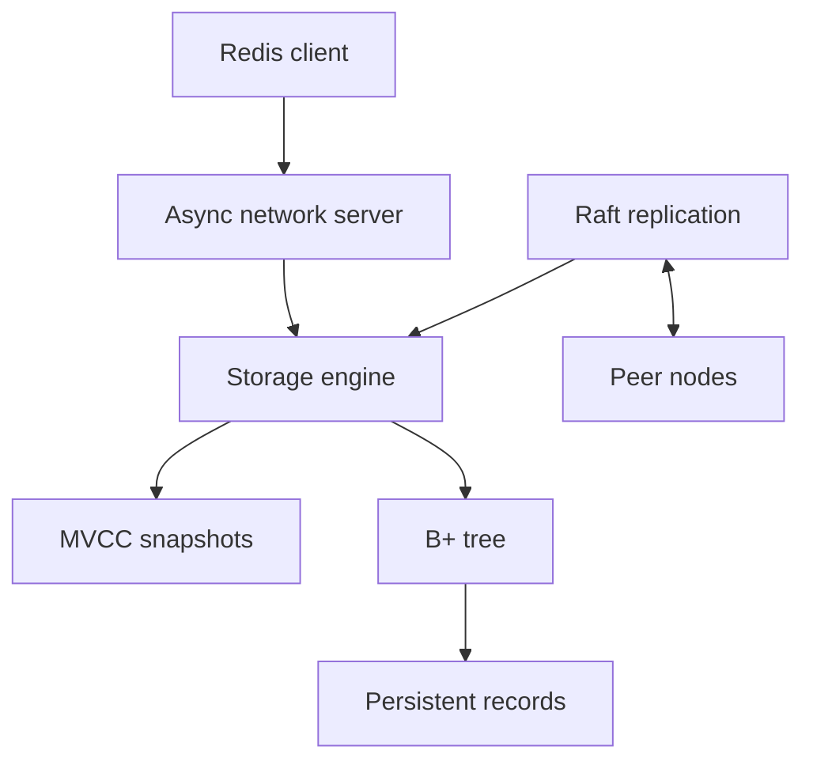
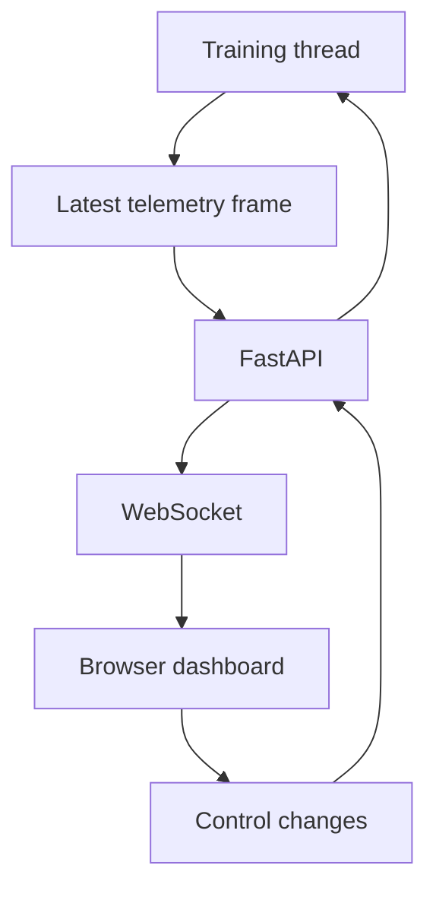
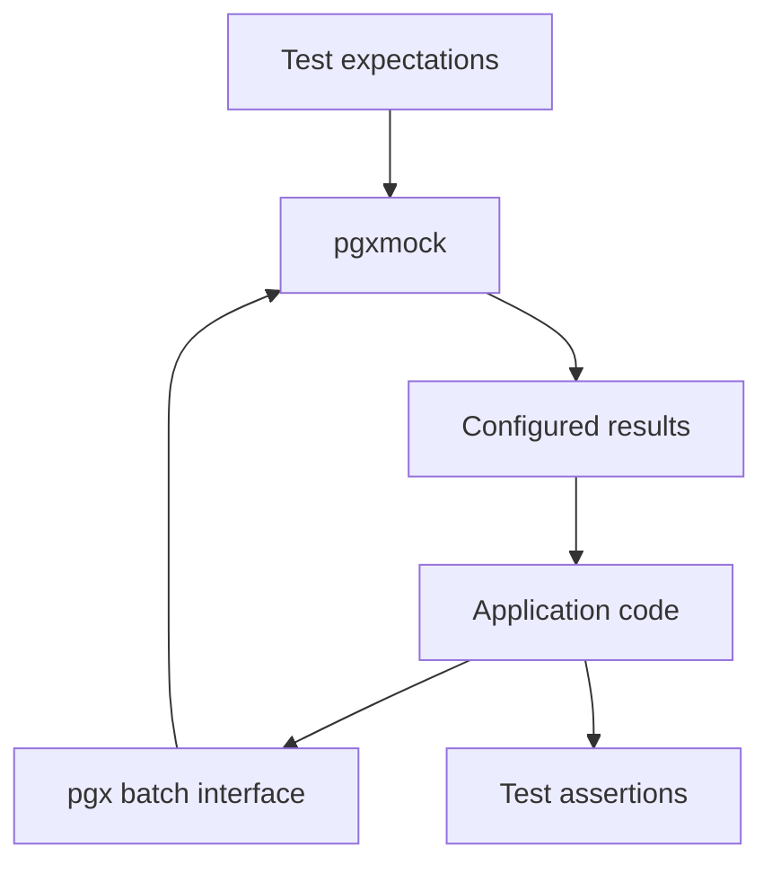

# Portfolio copy proposal

Phase 1 draft, 3 November 2026. No site implementation is authorized yet.

Facts come from the supplied PDF, transcribed into the root `resume.json` with your permission. Public repository references support the technical case study details. Editorial notes, destinations, and code syntax are not visible site copy. Only text inside `visible-copy` fences is intended for publication. These fences contain no dash characters.

## Structure

Five home page sections: hero, selected projects, experience, background, contact. Background contains education, all four awards, and volunteering. A separate About section and a separate skills wall are unnecessary.

Three case study pages: ImmuStore DB, GAN Observatory, and pgxmock. Litestar remains visible as an additional contribution within the projects section. This keeps all four resume projects represented while giving three projects room for technical detail.

Proposed paths: `/`, `/projects/immustore/`, `/projects/gan-observatory/`, `/projects/pgxmock/`. Route punctuation is not rendered as prose.

## Shared chrome and metadata

```visible-copy
Yabetse Tesfaye
Projects
Experience
Background
Contact
Resume PDF
Skip to content
Open menu
Close menu
Primary navigation
Back to home
Back to projects
© 2026 Yabetse Tesfaye
```

The wordmark links home. Desktop navigation has four section links and the resume link. On mobile, use the name, a visible Resume PDF link, and a labelled menu button; the dropdown contains the four section links. System color preference chooses the theme. Do not add a theme toggle unless requested, since it adds another header control without helping the primary task. Keyboard focus is visible. Escape and outside interaction close the menu. Navigation works without JavaScript through progressive enhancement.

Home title:

```visible-copy
Yabetse Tesfaye | Backend Software Engineer
```

Home description and Open Graph description:

```visible-copy
Backend engineer working with Python, Go, FastAPI, and PostgreSQL. Explore my projects, experience, and resume.
```

Open Graph image text, also used as its accessible description:

```visible-copy
Yabetse Tesfaye
Backend Software Engineer
Python · Go · FastAPI · PostgreSQL
```

## 1. Hero

```visible-copy
Yabetse Tesfaye
Backend Software Engineer
I build backend services, modernize APIs, and automate delivery with Python and Go.
Based in Addis Ababa, Ethiopia.
Resume PDF
GitHub
Email me
LinkedIn
Explore my work
```

The first three buttons point to the local resume PDF, the GitHub profile, and `mailto:yabtesfu@gmail.com`. LinkedIn is a quiet text link. The value statement uses the supplied summary and experience. Do not add an availability badge, remote employment claim, response time, or total years badge. Remote hiring is the audience; current availability is not established by the sources.

## 2. Selected projects

```visible-copy
Selected projects
Database internals, live systems, and developer tools.

ImmuStore DB
A Python database engine built to explore storage, transactions, and replication.
Python · B+ trees · MVCC · Raft
Read ImmuStore case study
View ImmuStore code

GAN Observatory
A live dashboard for GAN training, with streaming metrics and controls that take effect during a run.
Python · FastAPI · WebSockets
Read GAN Observatory case study
View GAN Observatory code

pgxmock
Extended batch query mocking for Go applications that use PostgreSQL through pgx.
Go · PostgreSQL · Testing
April 2024
Read pgxmock case study
View pgxmock code

Also contributed
Litestar
Contributed to OpenTelemetry tracing and exception capture in a Python ASGI framework.
July 2024
View Litestar repository
```

Project names, dates, links, and resume summaries are generated from JSON records by stable ID. Tags are backed by the resume or the linked repositories, then recorded in the canonical data during Phase 2. Do not assign dates to ImmuStore or GAN Observatory. Do not render an empty demo button.

## 3. Experience

Show all six roles in reverse chronological order. One sentence per role keeps the timeline short. Generate the role names, employers, and date labels from `resume.json`; the proposed display labels below normalize punctuation without changing facts. Do not merge the two later Eskalate roles. Avoid manually calculated duration badges.

```visible-copy
Experience

Revelo
LLM Trainer, AI Data Annotation and Model Evaluation
February 2026 to October 2026
Annotated video sequences and evaluated model responses for multimodal AI training.

Turing
LLM Trainer and AI Data Annotator
April 2025 to February 2026
Curated multimodal training data and reviewed AI responses for accuracy and consistency.

Upwork
FlutterFlow Mobile Application Developer
December 2024 to April 2025
Delivered FlutterFlow and Flutter applications with REST APIs, state management, and data validation for remote clients.

AfroChat, Eskalate
Backend Engineer and Project Co Lead
January 2023 to December 2024
Helped lead six backend engineers through a migration to FastAPI and PostgreSQL, with asynchronous data access and automated delivery.

Eskalate
Full Stack Developer, Internal Tooling
January 2021 to January 2023
Built workflow automation for 200+ employees across four time zones, alongside Go services and Kubernetes infrastructure.

Eskalate
Junior Full Stack Engineer
November 2019 to January 2021
Implemented authentication, authorization, and application features, and contributed to a project that placed third in a technology competition.
```

## 4. Background

Use compact lists, not large experience cards. Keep the four awards distinct, including the older innovation challenge and robotics hackathon. Display only the year when the source supplies only a year.

```visible-copy
Background

Education
Bachelor of Software Engineering
American College of Technology
September 2018 to June 2022
CGPA 3.82

Software Engineering Program
A2SV, Africa to Silicon Valley
January 2022 to March 2023
Data Structures and Algorithms

Awards
First place, Ethiopian Competitive Programming Contest, ALX
January 2024

First place, A2SV Project Competition, Atrons
September 2022
$8,000 team prize

Winner, UNDP and Ministry of Innovation and Technology COVID 19 Innovation Challenge
2020

Hackathon winner, Alpha 1S Robot Bluetooth Control
April 2021
Reverse engineered Bluetooth protocols to enable direct robot motor control.

Volunteering
Robotics Instructor, Eagle Robotics
2021
Mentored 30 students in Python and Raspberry Pi robotics.
```

Do not link Eagle Robotics until its intended working URL is verified. The four award dates above preserve the PDF order; alternatively the renderer may sort by date without changing the dates themselves.

## 5. Contact

```visible-copy
Contact
Have a backend engineering role in mind? Email me.
yabtesfu@gmail.com
Email me
Resume PDF
GitHub
LinkedIn
```

No contact form or client content fetch is needed. The supplied phone number remains in the resume and canonical JSON; it does not need to be another home page action.

## Case study: ImmuStore DB

Title and meta description:

```visible-copy
ImmuStore DB | Yabetse Tesfaye
A Python learning project exploring database storage, consistent snapshots, recovery, and replication.
```

```visible-copy
ImmuStore DB
Python database engine

Problem
A database needs to preserve committed data, give readers a consistent view, and replicate changes. This learning project explores those mechanisms directly.

What I built
I built a Python storage engine with B+ trees, MVCC snapshots, crash recovery, and Raft replication. An asynchronous server exposes Redis compatible commands.

Tradeoff
One writer per node keeps snapshot handling simpler, while limiting concurrent writes. Copy on write storage also needs compaction as old records accumulate.

Result
The project combines storage, networking, and replication in a learning database. Deterministic fault injection makes recovery behavior reproducible.

Architecture
Client commands pass through the network server to the storage engine. The tree publishes committed versions to persistent storage, while Raft coordinates replication between nodes.

View code
Run the example
Back to projects
```

Evidence: [README](https://github.com/yabtesfu/immustore-db/blob/main/README.md) and [architecture](https://github.com/yabtesfu/immustore-db/blob/main/docs/architecture.md). The problem statement reflects the documented learning project. The tradeoff describes documented implementation limits, not a performance benchmark.

The source PDF links to the old repository name, which currently redirects. Propose updating the site, canonical JSON URL, and PDF annotation together in Phase 2 to `https://github.com/yabtesfu/immustore-db`. The example link should point to the repository's `examples/` directory and be labelled as an example, not a hosted demo.

Mermaid draft, to be rendered as SVG during the build. Arrows below are syntax, not visible dash characters. Add a text description and SVG title in the output.



## Case study: GAN Observatory

Title and meta description:

```visible-copy
GAN Observatory | Yabetse Tesfaye
A FastAPI dashboard for monitoring and steering GAN training through live WebSocket metrics.
```

```visible-copy
GAN Observatory
Live ML monitoring platform

Problem
A saved training plot cannot show how a model changes while it learns or how a parameter adjustment affects the next steps.

What I built
I built a FastAPI and WebSockets dashboard that streams GAN training metrics at approximately 20 FPS. It includes live controls and mode collapse detection.

Tradeoff
The dashboard receives the latest available telemetry frame. A slow browser can miss intermediate frames, which keeps it from holding up training.

Result
Training can be observed and adjusted during a run. A repeatable demonstration makes mode collapse visible.

Architecture
A background training thread publishes the latest telemetry frame. FastAPI sends it to the browser through a WebSocket and accepts control changes for the training session.

View code
Run the demo locally
Back to projects
```

Evidence: [README](https://github.com/yabtesfu/gan-lab-tensorflow/blob/main/README.md) and [session implementation](https://github.com/yabtesfu/gan-lab-tensorflow/blob/main/src/gan_lab_tensorflow/live/session.py). The approximately 20 FPS figure is in both the resume and repository; it is not a new benchmark measured by this audit. The local demo link points to the README's installation instructions. There is no supplied hosted demo URL.



## Case study: pgxmock

Title and meta description:

```visible-copy
pgxmock | Yabetse Tesfaye
Batch query mocking for Go and PostgreSQL applications using pgx interfaces.
```

```visible-copy
pgxmock
Go testing contribution
April 2024

Problem
Applications that send queries in batches need tests that can model the calls and their expected results.

What I built
I extended batch query mocking for Go and PostgreSQL testing with pgx interfaces.

Tradeoff
Mocked database calls make application behavior easier to test in isolation. They still need integration tests against PostgreSQL to check database behavior.

Result
The contribution extends the batch testing surface available to applications using pgx.

Architecture
The application sends a batch through the pgx interface. The mock matches expected queries and returns configured results to the test.

View contribution repository
View usage examples
Back to projects
```

Evidence: supplied resume, [README](https://github.com/abelkm99/pgxmock/blob/master/README.md), [batch dispatch](https://github.com/abelkm99/pgxmock/blob/master/pgxmock.go), and [batch expectations](https://github.com/abelkm99/pgxmock/blob/master/expectations.go). The linked repository is a fork, not the upstream project. The resume is the authority for personal contribution and date; repository code confirms batch support exists but does not by itself prove authorship or upstream merge status. Do not claim a merged pull request, maintainer role, or measured test speed improvement.

The tradeoff is a proposed engineering explanation. It is not documented as your personal decision. Confirm or replace it before publication to meet the requirement for a tradeoff you actually made. The usage examples link points into the repository, not a hosted demo.



## Signature element, choose one

### Option A: Request path

A single compact line diagram beside the hero connects four labelled nodes. It gives the otherwise restrained page a recognizable backend identity. Static by default; one subtle highlight may follow keyboard focus or pointer focus. It uses no network calls or invented live metrics. On mobile, the same diagram stacks below the primary actions without pushing those actions off screen.

```visible-copy
Request
Validate
Store
Respond
```

### Option B: Versioned record

A small visual of two storage roots connected to a shared set of records, inspired by ImmuStore snapshots. Use one static SVG near the hero, with a clear accessible description. No second decorative system, particle canvas, cursor effect, or animated loader.

```visible-copy
One change. A consistent view.
Previous version
Current version
Shared records
```

Recommendation: Option A communicates backend engineering most quickly to a recruiter. Choose only one. Both use the same blue accent as the rest of the site. Ordinary focus and hover transitions stay subtle; reduced motion removes all nonessential animation and smooth scrolling.

## Approval items

Approve the five section structure and the PDF transcription, choose signature A or B, and confirm the proposed pgxmock tradeoff. An exact Eagle Robotics link and contribution pull request links would strengthen the evidence, but missing links must never be replaced with guesses. The LinkedIn URL is unchanged between the new PDF and the site, so no new handle has been inferred.
